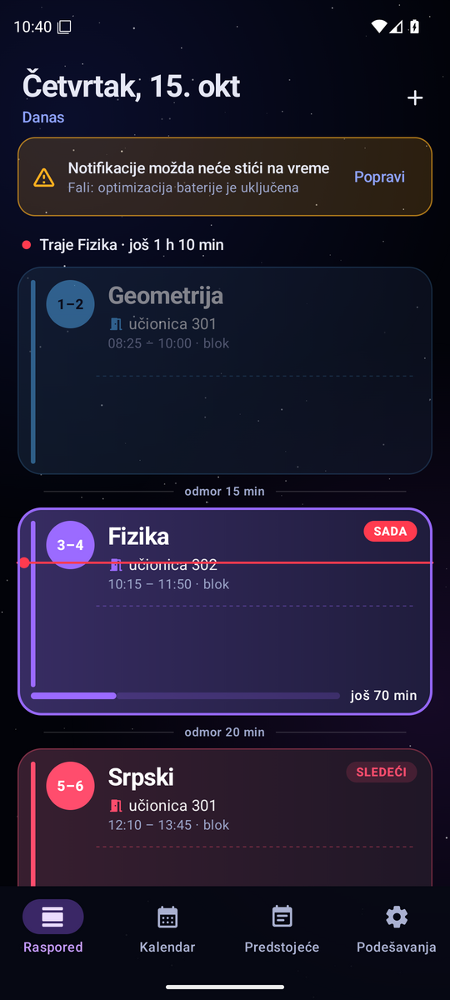
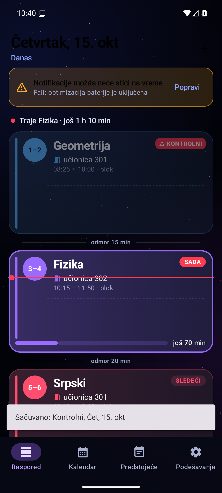
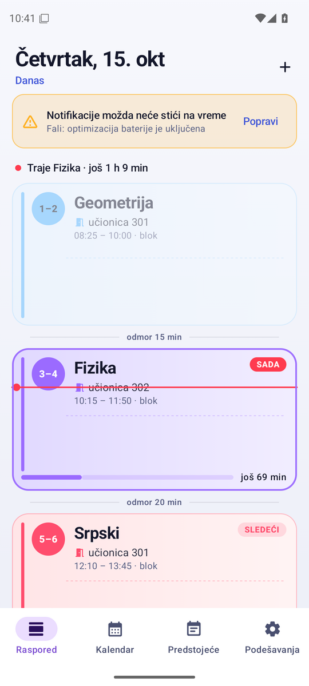
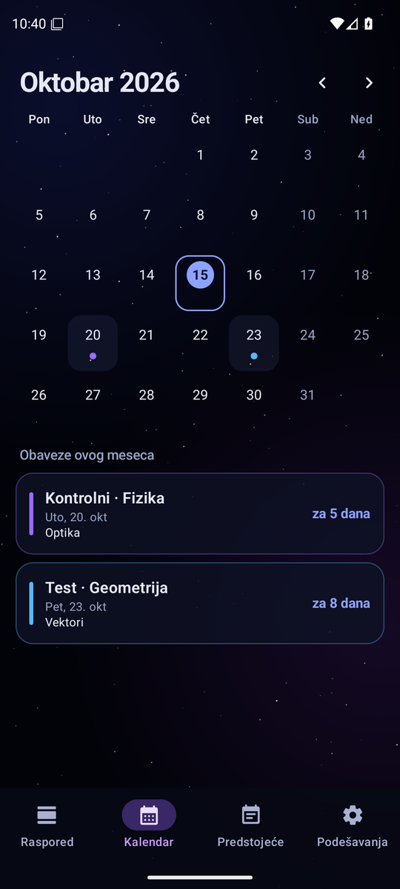
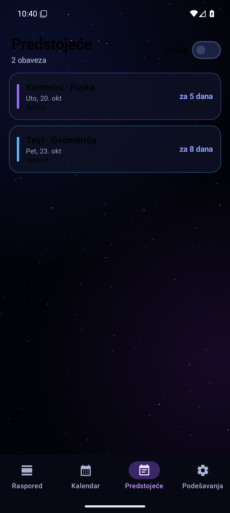
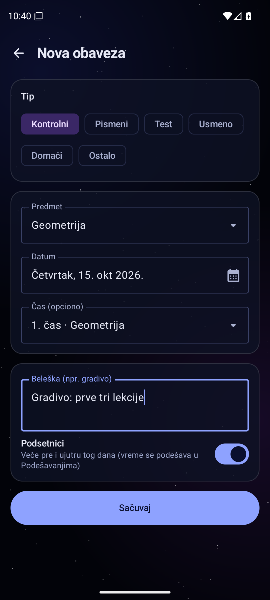
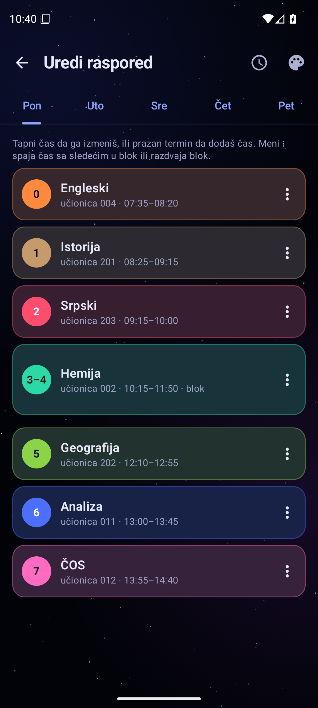
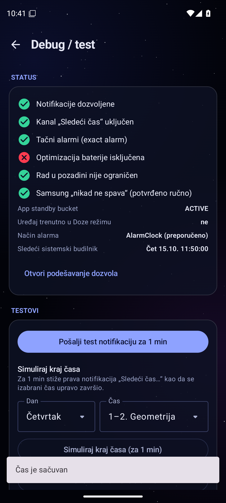
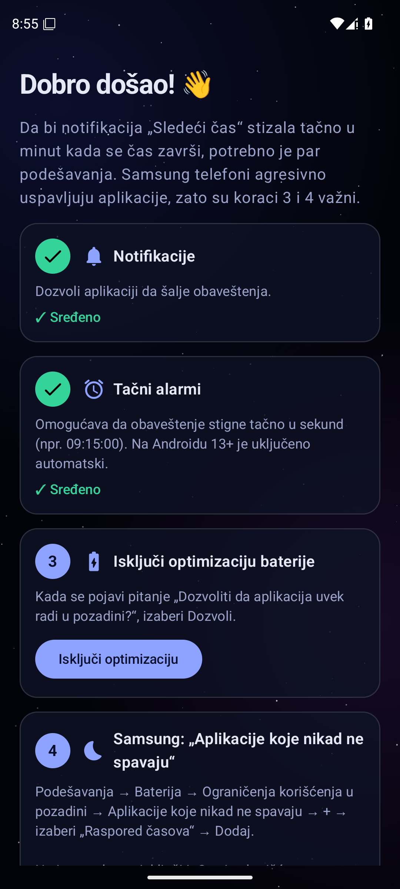

# Raspored časova 📚

Native Android aplikacija (Kotlin + Jetpack Compose, Material 3, Room) za školski raspored časova.
Kad otvoriš aplikaciju odmah vidiš današnji raspored po bojama, prevlačenjem levo/desno ideš na
prethodni/sledeći školski dan, dodaješ kontrolne kao u Google Calendaru — i **tačno u minutu kad se čas
završi** stiže notifikacija koji je sledeći čas i u kojoj učionici.

| | | |
|---|---|---|
|  |  |  |
| Današnji raspored, trenutni čas i crvena linija „sada“ | Badge ⚠ KONTROLNI na kartici | Svetla tema |
|  |  |  |
| Mesečni kalendar sa tačkicama | Predstojeće sa odbrojavanjem | Dodavanje kontrolnog |
|  |  |  |
| Izmene rasporeda | Debug / test ekran | Onboarding (dozvole, baterija, Samsung) |

Ostali screenshotovi: [docs/screenshots](docs/screenshots). Svi su napravljeni automatski na Android 16 emulatoru u CI-ju.

## Šta aplikacija radi

**Dnevni prikaz**
- Otvara današnji dan; vikendom otvara ponedeljak uz oznaku „Vikend, sledeći je ponedeljak“.
- `HorizontalPager` kroz školske dane (pon–pet) sa pravim datumima („Četvrtak, 15. okt“), animacijom pri
  swipe-u i dugmetom **Danas**.
- Kartice časova po vremenu, visina srazmerna trajanju (blok/dvočas = jedna visoka kartica), na kartici:
  broj časa (od 0), predmet, učionica, vreme. Pauze kao tanak razmak („odmor 15 min“, „bez odmora“).
- Trenutni čas istaknut, sa progress barom i „još X min“, plus crvena linija **sada** kao u Google Calendaru.
- Badge **⚠ KONTROLNI** (ili PISMENI, TEST, USMENO, DOMAĆI…) na času za koji je nešto zakazano.
- Tamna „svemirska“ tema (podrazumevana), svetla ili sistemska.

**Kontrolni / testovi**
- Tip, predmet, datum, opciono čas tog dana, beleška (gradivo), podsetnici uključeni/isključeni.
- Dug pritisak na karticu časa → „Dodaj kontrolni za ovaj čas“.
- Mesečni kalendar sa tačkicama u bojama predmeta; tap na dan otvara taj dan.
- Lista „Predstojeće“ sa odbrojavanjem („sutra“, „za 3 dana“).
- Podsetnici: veče pre (podrazumevano 19:00) i ujutru tog dana (07:00) — oba vremena se podešavaju.

**Notifikacije**
- Na kraju časa: „Sledeći čas: Fizika“ · „učionica 302 · počinje u 10:15 · 3–4. čas“, uz ⚠ ako je na
  tom času kontrolni.
- Za blok stiže posle celog bloka; opciono i između dva dela bloka.
- Posle poslednjeg časa: „Kraj nastave za danas 🎉“ + šta je sutra (ili u ponedeljak) i da li ima kontrolni.
- Opcioni podsetnik X minuta pre prvog časa (isključen po defaultu).
- Nema notifikacija o časovima vikendom i danima označenim kao neradni (praznik, raspust – dan ili period).
  Podsetnici za kontrolne rade i vikendom (npr. nedelja uveče za ponedeljak).

**Izmene**
- Sve se menja iz aplikacije: predmet (dropdown postojećih ili novi), učionica, boja (paleta + nijansa),
  termini časova, dodavanje/brisanje časova, spajanje u blok i razdvajanje bloka.
- Izvoz/uvoz svega u JSON (backup) i „Vrati originalni raspored“.

**Debug / test ekran** (Podešavanja → Debug / test)
- „Pošalji test notifikaciju za 1 min“, „Simuliraj kraj časa“ (prava notifikacija za izabrani čas za 1 min).
- Lista svih zakazanih alarma, log isporuke: zakazano vs. stvarno vreme + kašnjenje (zeleno < 5 s).
- Status dozvola, optimizacije baterije, standby bucket-a, Doze režima.

## Zašto `setAlarmClock` (pouzdanost na Samsungu)

Notifikacije se ne okidaju preko WorkManager-a (on namerno kasni i grupiše posao), nego preko **tačnih
alarma iz `AlarmManager`-a**. Podrazumevano se koristi **`AlarmManager.setAlarmClock()`**:

| | `setAlarmClock` (default) | `setExactAndAllowWhileIdle` |
|---|---|---|
| Doze režim | sistem **izlazi iz Doze-a** malo pre alarma, alarm se nikad ne odlaže | radi u Doze-u, ali uz kvotu/ograničenje učestalosti po aplikaciji |
| App Standby bucket (rare/restricted) | ne utiče | može da ograniči |
| Samsung „uspavane“ aplikacije | tretira se kao budilnik – najveća šansa da prođe | češće se odlaže |
| Mana | ikonica budilnika u statusnoj traci, „sledeći alarm“ se vidi na zaključanom ekranu | — |

Zato je `setAlarmClock` izbor za ovu aplikaciju — bitnije je da notifikacija stigne u 09:15:00 nego da
nema ikonice. U Podešavanjima → Pouzdanost može da se prebaci na `setExactAndAllowWhileIdle`.

Ostatak „pojasa i tregera“:
- `USE_EXACT_ALARM` (Android 13+, automatski odobrena; aplikacija ne ide na Play Store) i `SCHEDULE_EXACT_ALARM` za Android 12.
- Alarmi se ponovo zakazuju posle: restarta telefona (`BOOT_COMPLETED`), promene vremena (`TIME_SET`),
  vremenske zone (`TIMEZONE_CHANGED`), update-a aplikacije (`MY_PACKAGE_REPLACED`), dobijanja dozvole za
  tačne alarme, **svake izmene** rasporeda/kontrolnih/podešavanja i posle svake isporučene notifikacije.
- Zakazuje se 7 dana unapred; dnevni „maintenance“ alarm u 00:05 pomera prozor (radi i tokom raspusta).
- Notifikacioni kanali visokog prioriteta (`IMPORTANCE_HIGH`), notifikacija se postavlja odmah u
  `BroadcastReceiver`-u, a tek onda se upisuje log i radi ponovno zakazivanje.
- Onboarding traži dozvolu za notifikacije, proverava tačne alarme, traži isključenje optimizacije
  baterije (`REQUEST_IGNORE_BATTERY_OPTIMIZATIONS`) i vodi kroz Samsung „Aplikacije koje nikad ne spavaju“.
  Ako nešto fali, glavni ekran prikazuje upozorenje sa dugmetom „Popravi“.

## Instalacija na telefon

1. Na telefonu otvori **Releases** stranicu repoa i skini `raspored-casova-vX.Y.Z.apk`.
2. Otvori skinuti fajl → dozvoli „Instaliranje nepoznatih aplikacija“ za pregledač/My Files → Instaliraj.
3. U onboardingu prihvati: notifikacije, (tačni alarmi su na Androidu 13+ već uključeni), „Dozvoli“ za rad
   u pozadini bez optimizacije baterije, pa dodaj aplikaciju u Samsung **Aplikacije koje nikad ne spavaju**:
   *Podešavanja → Baterija → Ograničenja korišćenja u pozadini → Aplikacije koje nikad ne spavaju → + → Raspored časova*.
   Dodatno: *Podešavanja → Aplikacije → Raspored časova → Baterija → Neograničeno*.
4. U Podešavanja → Debug / test pošalji test notifikaciju i proveri kašnjenje.

**Nova verzija** se instalira preko postojeće (isti potpisni ključ) — podaci ostaju. Samo skini novi APK iz
Release-a i instaliraj ga. Za svaki slučaj pre update-a: Podešavanja → Izvezi u JSON.

## Build

Zahtevi: JDK 17+, Android SDK (platforma 37). Gradle wrapper sam skida Gradle 9.8.1.

```bash
./gradlew :core:test                 # logika (planer notifikacija, raspored) – čist JVM
./gradlew :app:testDebugUnitTest     # Robolectric: Room, backup, AlarmManager, receiver
./gradlew :app:assembleDebug         # debug APK (paket com.kostaking.raspored.debug, može uz release)
./gradlew :app:connectedDebugAndroidTest   # UI testovi na emulatoru/telefonu
```

Struktura:
- `core/` – čist Kotlin: model, `Timetable`, `NotificationPlanner` (koja notifikacija kad), `DayTimeline`,
  `SchoolDayPager`, početni raspored. Najvažnija logika je ovde i pokrivena je unit testovima.
- `app/` – Android: Room baza, `AlarmScheduler` (tačni alarmi), `AlarmReceiver`, `SystemEventsReceiver`,
  Compose UI (dnevni prikaz, kalendar, predstojeće, editori, podešavanja, debug, onboarding).
- `ci/emulator-tests.sh` – testovi na emulatoru (UI, Doze, promena vremena, update, restart).

## Release i potpisivanje

`.github/workflows/release.yml` na svaki tag `v*` builduje **potpisan** release APK i kači ga uz GitHub
Release. Ključ za potpisivanje je u GitHub Secrets (nikad u repou):

| Secret | Vrednost |
|---|---|
| `RELEASE_KEYSTORE_BASE64` | keystore (`raspored-release.p12`) kodiran u base64 |
| `RELEASE_STORE_PASSWORD` | lozinka keystore-a |
| `RELEASE_KEY_ALIAS` | `raspored` |
| `RELEASE_KEY_PASSWORD` | lozinka ključa (ista kao lozinka keystore-a) |

Podešavanje: GitHub → repo → **Settings → Secrets and variables → Actions → New repository secret**.

Nova verzija: **Actions → Release → Run workflow** → upiši tag (npr. `v1.0.1`) → Run (tag se pravi automatski na izabranoj grani), ili `git tag v1.0.1 && git push origin v1.0.1`.
`versionName` = broj iz taga, `versionCode` = major·10000 + minor·100 + patch.

**Backup ključa:** keystore + lozinke čuvaj na bar dva mesta van GitHub-a (npr. menadžer lozinki tipa
Bitwarden/1Password kao prilog + privatni folder na Google Drive-u ili USB). Ako se ključ izgubi, nova
verzija ne može da se instalira preko stare – morala bi deinstalacija (pre toga izvezi JSON backup).

## Testiranje

- `core` unit testovi (JUnit): sledeći čas, tačna vremena svih notifikacija, blokovi, poslednji čas,
  slobodni časovi, vikend, neradni dani, kontrolni u notifikaciji, prelazak dana u ponoć, podsetnici.
- Robolectric: repozitorijum (spajanje/razdvajanje bloka, preklapanja, reset), JSON backup round-trip,
  `AlarmScheduler` (tačni `setAlarmClock` alarmi, zamena starih, vremenska zona, bez dozvole), receiver
  (notifikacija + log kašnjenja).
- Emulator (GitHub Actions, API 36): UI tura kroz sve ekrane (swipe, dodavanje kontrolnog, kalendar,
  izmene, tema), isporuka u **Doze** režimu (`dumpsys deviceidle force-idle`) za oba načina alarma,
  ponovno zakazivanje posle promene vremena, update-a i **restarta**.
